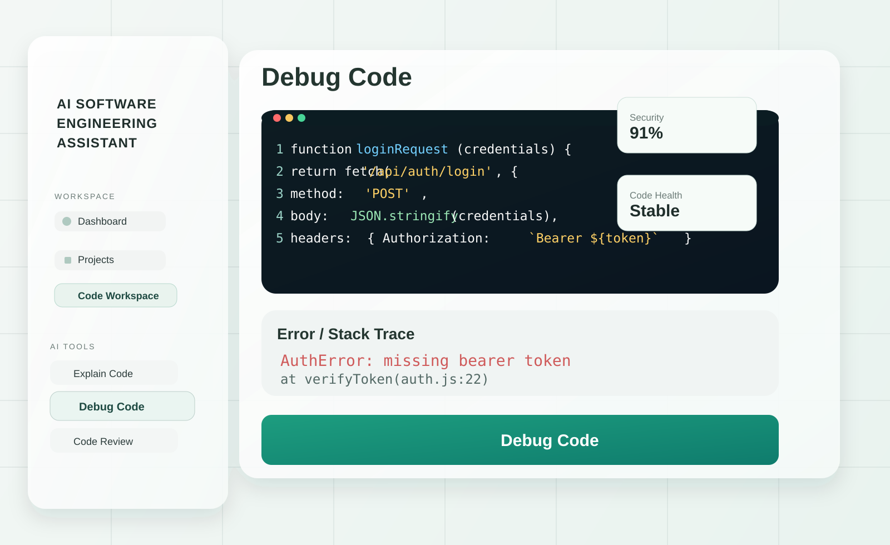

# AI Software Engineering Assistant

<p align="center">
  
  
  
  
</p>

<p align="center">
  <a href="http://localhost:5173" target="_blank">
    
  </a>
  <a href="http://localhost:8000/docs" target="_blank">
    
  </a>
</p>

<p align="center">
  
</p>

A polished AI-powered engineering workspace designed to help developers analyze, debug, review, refactor, document, and understand code with a modern dashboard experience.

## Why this project?

AI-powered software engineering workflows are often fragmented across tools, tabs, and disconnected interfaces. This project brings everything into one workspace:

- code review and debugging assistance
- project-level analysis and insight
- test generation and refactoring guidance
- API-backed AI chat workflows
- clean dashboard UX for developer productivity

## Key features

- Intelligent code analysis and explanation
- Debug assistance with error trace support
- Automated test generation
- Documentation generation for code and APIs
- Code review and refactor suggestions
- Project upload and indexing workflow
- Secure auth with JWT tokens
- SQLite-backed persistence for projects and history
- 3D project intelligence visualization

## Tech stack

- Frontend: React, Vite, React Router, Framer Motion
- 3D interface: React Three Fiber / Drei
- IDE experience: Monaco Editor
- Backend: FastAPI, SQLite, JWT auth
- AI layer: local deterministic analysis with optional OpenAI-compatible provider support

## App preview

<p align="center">
  
</p>

## Local setup

### 1) Install frontend dependencies

```bash
npm install
```

### 2) Start the frontend

```bash
npm run dev -- --host 0.0.0.0
```

Open the app at: http://localhost:5173

### 3) Start the backend

```powershell
py -m venv backend\.venv
backend\.venv\Scripts\Activate.ps1
pip install -r backend\requirements.txt
Copy-Item backend\.env.example backend\.env
uvicorn app.main:app --app-dir backend --reload --port 8000
```

> Make sure `JWT_SECRET` is set in `backend/.env` before using authentication features.

## Environment configuration

Create or update `backend/.env` with the values below:

```env
JWT_SECRET=your-long-random-secret
DATABASE_PATH=./backend/data/assistant.db
CORS_ORIGINS=http://localhost:5173,http://127.0.0.1:5173
MAX_UPLOAD_MB=20
LLM_API_KEY=
LLM_MODEL=gpt-4o-mini
LLM_BASE_URL=https://api.openai.com/v1
```

If no LLM key is configured, the app continues to work using local deterministic analysis and templates.

## Project structure

```text
ai-swe-assistant/
├── backend/
│   ├── app/
│   ├── data/
│   ├── tests/
│   ├── .env
│   ├── .env.example
│   └── requirements.txt
├── src/
├── public/
├── docs/
│   └── screenshots/
├── package.json
├── package-lock.json
├── vite.config.js
├── index.html
├── README.md
├── RUN_ME.md
└── .gitignore
```

## Run tests

```powershell
Set-Location backend
python -m unittest discover -s tests -v
```

## Production-ready workflow

```bash
git init
git add .
git commit -m "Initial commit"
git branch -M main
git remote add origin <your-github-repo-url>
git push -u origin main
```

## Notes

- Supports explain, review, debug, test, refactor, docs, and chat workflows.
- Project indexing stores supported text files and enables keyword-based retrieval.
- Password reset emails are not enabled by default without a mail provider.

## Future direction

This project is designed to evolve into a practical software engineering assistant for rapid debugging, code understanding, project intelligence, and AI-assisted delivery workflows.

---

<p align="center">
  Built with ❤️ for developers who want faster, smarter engineering workflows.
</p>
